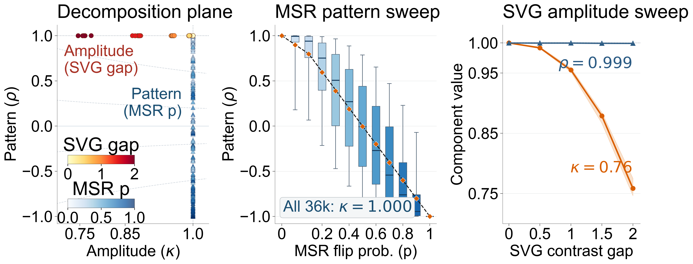
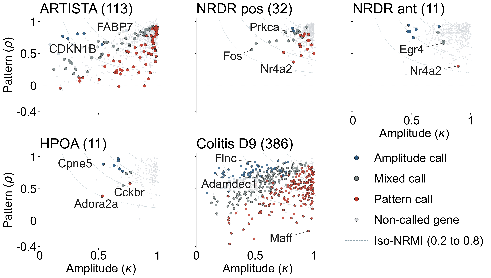
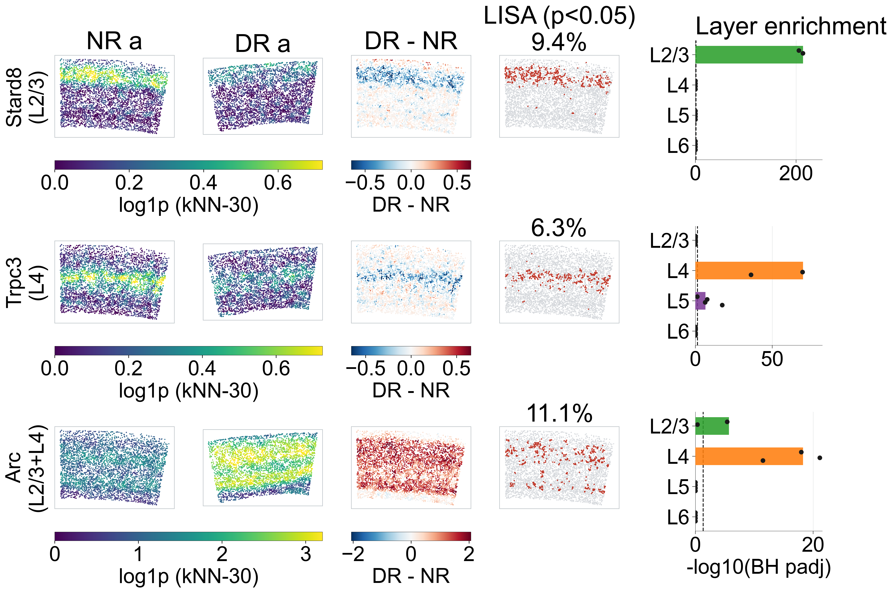
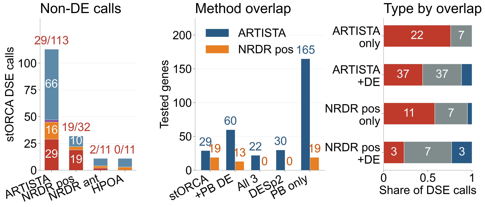
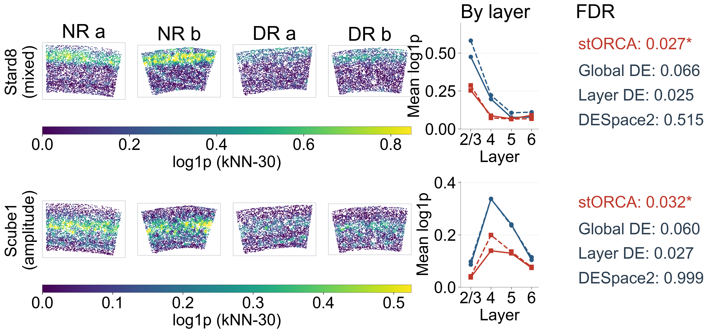
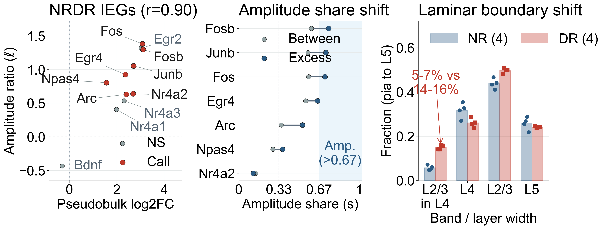

# Result (Figure 5)

## stORCA는 각 변화의 종류와 위치를 밝히며, DE가 call하지 않는 변화도 찾는다

call은 한 유전자의 공간 발현이 조건 사이에서, replicate section 사이보다 더 크게 다르다는 뜻입니다. 생물학자는 그다음 세 가지를 묻습니다. 어떤 종류의 변화인가, 즉 새로운 모양인가 아니면 같은 모양의 다른 세기인가? 조직의 어디에서 일어났는가? 더 단순한 검정으로도 찾을 수 있었는가? stORCA는 첫 질문에 ROS를 pattern 항 $\rho_W$와 amplitude 항 $\kappa$로 분해해 답합니다(Methods). 두 번째 질문에는 matching된 발현 field의 residual로 답하며, 이 residual은 지도로 그릴 수 있고 조직 annotation과 비교해 검정할 수 있습니다. 세 번째 질문을 위해, 같은 section에서 돌린 두 검정과 call을 비교했습니다. Pseudobulk differential expression(DE)은 section 전체나 한 domain 안에서 총 발현이 바뀌는지를 묻습니다. DESpace2는 조건이 domain마다 발현을 다르게 바꾸는지를 묻기 때문에, 모든 domain에 같은 변화는 그 질문 밖에 있습니다. 먼저 종류를 아는 변화에서 분해를 확인했고, 그다음 세 가지 읽기를 replicate 비교 다섯 개에 적용했습니다(Fig. 5).

변화의 종류를 알 때, 분해는 amplitude와 pattern을 구분했습니다(Fig. 5a). Amplitude 시리즈에서는 유전자 10개가 하나의 공간 template을 유지한 채 조건 사이 대비가 0에서 2까지 커졌고, 조건마다 section은 세 장이었습니다. 대비가 커지면서 조건 사이 쌍 9개에 대한 $\kappa$ 중앙값은 1.00에서 0.99, 0.96, 0.88, 0.76으로 떨어졌고, $\rho_W$는 0.999 이상을 유지했습니다. 대비 0.5부터는 amplitude 항이 손실의 97% 이상을 차지했습니다. Pattern 시리즈에서는 대응을 고정하고, 각 유전자의 세기는 그대로 둔 채 모양만 무작위로 바꿨습니다. 이를 위해 각 공간 eigenmode의 부호를 확률 *p*로 뒤집었으므로, $\rho_W$의 기댓값은 $1-2p$입니다. 무작위 profile 36,000개에서 $\kappa$는 모두 1.000이었고, $\rho_W$의 평균은 $1-2p$를 따라 1.00에서 $-1.00$까지 움직였습니다. 개별 profile은 이 평균 주위에 퍼졌으며, *p* = 0.3에서 $\rho_W$의 5번째에서 95번째 백분위는 $-0.47$에서 0.96이었습니다. 지도는 한 유전자에서 두 종류의 변화를 보여줍니다(Fig. 5a, 오른쪽).

이 분해를 네 데이터셋의 비교 다섯 개에 적용했고, 모두 두 조건에 replicate section이 있었습니다. ARTISTA는 Stereo-seq로 axolotl 종뇌 재생을 추적한 데이터이며, 손상 후 2일(DPI) section 세 장과 20 DPI section 세 장을 비교해 조건 사이 쌍 9개와 조건 안 쌍 6개를 얻었습니다. NRDR은 MERFISH로 출생 후 28일의 정상 사육 마우스와 암사육 마우스의 일차 시각피질(V1)을 비교하며, 조건마다 동물이 두 마리입니다. 동물마다 뒤쪽 section 하나와 앞쪽 section 하나가 있습니다. 한 동물의 두 section은 서로 독립이 아니므로, 두 위치를 별개의 2 대 2 설계로 분석했습니다. HPOA는 MERFISH로 수컷의 시상하부 시각교차앞 영역을 비교하며, naive 세 마리와 새끼를 공격한 세 마리입니다. Colitis 비교는 건강한 대장 slice 세 장과 dextran sulfate sodium 대장염 9일째 slice 세 장을 대비합니다. 한 조건의 slice는 한 마우스에서 왔으므로 technical replicate입니다. stORCA는 유전자를 775, 377, 362, 148, 480개 검정했고 113, 32, 11, 11, 386개를 call했습니다(one-sided limma, BH 보정 *P* < 0.05). 조건 사이 쌍마다 concordance 손실 중 amplitude가 차지하는 비율 $s$를 계산했습니다. 쌍은 $s<1/3$ 또는 $\rho_W\le0$이면 pattern, $s>2/3$이면 amplitude, 나머지는 mixed로 분류했습니다. 각 유전자는 조건 사이 쌍에서 가장 자주 나온 type을 받았습니다. Type은 call을 설명할 뿐, 검정에는 들어가지 않습니다.

Call은 세 type 모두에 걸쳤고, 그 비율은 데이터셋마다 달랐습니다(Fig. 5b). ARTISTA(pattern 59, mixed 44, amplitude 10)와 colitis(160, 157, 69)에서는 pattern call이 가장 많았습니다. NRDR 뒤쪽에서는 pattern과 mixed가 같았습니다(14, 14, 4). HPOA(2, 3, 6)와 NRDR 앞쪽(1, 4, 6)에서는 amplitude call이 가장 많았고, 둘 다 call이 11개였습니다. 조건 사이 type에는 replicate section끼리도 이미 보이는 변화가 섞일 수 있습니다. 그래서 조건 사이 쌍이 조건 안 쌍을 넘는 초과분으로도 type을 매겼습니다. 이렇게 해도 type이 유지된 call은 ARTISTA 113개 중 84개(74%), NRDR 뒤쪽 32개 중 21개(66%), colitis 386개 중 270개(70%)였습니다. NRDR 앞쪽과 HPOA에서는 11개 중 각각 10개와 8개가 type을 유지했습니다. 바뀐 call은 대부분 amplitude 쪽으로 움직였고, ARTISTA의 amplitude call은 10개에서 29개로 늘었습니다.

ARTISTA의 call 두 개가 각 type이 조직에서 어떻게 보이는지 보여줍니다(Fig. 5b, 오른쪽). *CDKN1B*는 amplitude로 분류되었습니다($\kappa$ 0.24, $\rho_W$ 0.74, $s$ 0.82; BH 보정 *P* = 5 × 10−9). 20 DPI에서 양쪽 반구의 뇌실 띠를 따라 발현이 올라갔고, 공간 구조가 더 강해졌습니다($h$ = 2.11). Residual은 네 compartment 모두에서 비슷하게 올라갔으며, 조건 사이 쌍 9개에 대한 중앙값은 0.14에서 0.17이었습니다. *FABP7*은 pattern으로 분류되었습니다($\kappa$ 0.96, $\rho_W$ 0.75, $s$ 0.12; BH 보정 *P* = 2 × 10−6). 증가는 손상된 반구의 등쪽 절반에 집중되었고, residual 중앙값은 0.68로 다른 compartment의 0.39에서 0.48보다 컸습니다. 손상된 등쪽 compartment는 쌍 9개 모두에서 residual이 가장 컸습니다. Global pseudobulk DE도 두 유전자를 모두 call하므로, 이 둘은 type의 예시이지 DE 너머의 검출 예시가 아닙니다.

NRDR 뒤쪽에서 32개 call 중 30개의 residual이 특정 피질 layer에 모였습니다(Fig. 5c). 네 section에 cell-type annotation으로 layer를 그리고, 각 section을 pia가 위로 오도록 놓았습니다(Fig. 5c, 왼쪽). 모든 call과 조건 사이 쌍에 대해, 절대 residual이 국소 hotspot을 이루는 세포를 표시했습니다(local Moran's *I*, high-high, permutation *P* < 0.05). 그다음 각 layer에 hotspot 세포가 과다한지 검정했습니다(hypergeometric 검정, 네 layer에 대한 BH). Hotspot은 유전자당 source 세포의 중앙값 5.5%(2.8%에서 13.2%)를 덮었습니다. 한 유전자에서 조건 사이 쌍 네 개 중 세 개 이상에서 enrichment된 layer를 셌습니다. L4는 call 21개, L2/3은 13개, L5는 4개, L6는 2개에서 enrichment되었습니다. Cell type으로는 L4 neuron이 call 20개, L2/3 neuron이 19개에서 enrichment되었습니다. *Stard8*은 L2/3에서 바뀌었으며, 정상 사육 section의 띠가 암사육 section에서 약해졌습니다. *Trpc3*는 L4에서 바뀌었고, *Arc*는 L2/3과 L4 전반에서 올라갔습니다. L4는 시상의 시각 입력을 받고 L2/3은 그 주된 피질 중계이므로, residual은 시각 박탈에 반응할 것으로 예상되는 layer에 놓였습니다.

DE나 DESpace2 call이 없는 stORCA call은 대부분 pattern 변화였고, pseudobulk DE와 겹친 call에는 amplitude 변화가 대부분 들어 있었습니다(Fig. 5d). ARTISTA에서 DESpace2는 stORCA call 113개 중 24개를 call했습니다. 나머지 89개 중 60개는 pseudobulk DE가 call했고 29개는 어느 검정도 call하지 않았습니다. NRDR 뒤쪽에서 DESpace2는 layer를 domain으로 했을 때 유전자를 하나도 call하지 않았습니다. Pseudobulk DE는 stORCA call 32개 중 13개를 call했고, 19개는 어느 쪽도 call하지 않았습니다. NRDR 앞쪽에서는 이런 call이 11개 중 2개, HPOA에서는 11개 중 0개였습니다. DE call이 없는 ARTISTA call 29개는 pattern 22, mixed 7, amplitude 0이었고, NRDR의 19개는 pattern 11, mixed 7, amplitude 1이었습니다. DE와 겹친 call에는 ARTISTA amplitude call 10개가 모두 들어 있었습니다(pattern 37, mixed 37, amplitude 10). Amplitude 변화는 pseudobulk DE가 재는 총량을 바꾸지만, pattern 변화는 총량을 유지한 채 발현을 옮길 수 있습니다. 겹침은 반대 방향으로도 있습니다. Pseudobulk DE만 call한 유전자가 ARTISTA에 165개, NRDR 뒤쪽에 19개였고, DESpace2는 stORCA가 call하지 않은 ARTISTA 유전자 30개를 call했습니다. 공간 구조의 변화 없이 수준만 바뀐 변화는 ROS의 centering에서 제거되므로, 이 유전자들은 여기서 검정한 의미의 공간 변화가 아닙니다.

이름을 붙인 NRDR 유전자들이, 조건당 section 두 장에서 다른 검정이 call하지 않은 call을 보여줍니다(Fig. 5e). Call 두 개는 layer DE였지만 global DE나 DESpace2의 call은 아니었습니다. *Stard8*(stORCA BH 보정 *P* = 0.027)은 암사육 section 두 장 모두에서 L2/3 띠가 약했고, global DE는 FDR 0.066, layer DE는 0.025, DESpace2는 0.52였습니다. *Scube1*(amplitude, 0.032)은 L4 정점을 더 약한 세기로 유지했고, global DE 0.060, layer DE 0.027, DESpace2 0.999였습니다. Call 세 개는 어느 layer에서도 DE가 아니었습니다. *Prkca*(0.044)는 정상 사육 section 두 장 모두의 L2/3과 L4에서 높았고, 암사육 section 두 장 모두에서 L5 수준으로 떨어졌습니다. Global DE는 FDR 0.17, 가장 작은 layer FDR은 0.10, DESpace2는 0.999였습니다. *Trpc3*(0.040)는 L4 띠가 약했습니다(global 0.40, layer 0.11, DESpace2 0.999). *Slc24a3*(pattern, 0.027)은 L4 정점이 평평해졌습니다(global 0.22, layer 0.052, DESpace2 0.60). 모든 경우에서 변화는 각 조건의 두 동물 모두에 보이며, layer 평균도 같은 대비를 보입니다.

NRDR call의 방향은 원 연구와 일치합니다(Fig. 5f). 원 연구는 암사육 V1에서 immediate early gene의 발현이 높다고 보고했습니다. stORCA는 activity 유전자 11개 중 7개를 call했고, 7개 모두 암사육 section에서 공간 구조가 더 강했습니다($h$ 0.63에서 1.38). 11개 유전자 전체에서 $h$는 pseudobulk log2 fold change와 11개 모두 부호가 같았고, 둘의 Pearson 상관은 *r* = 0.90이었습니다. 조건 안 쌍을 넘는 초과분으로는 call 세 개가 amplitude(*Fos*, *Fosb*, *Junb*), 세 개가 mixed, 한 개가 pattern(*Nr4a2*)이었습니다. 이는 모양의 변화보다 세기의 증가에 가깝다는 것과 일치합니다. Layer 지도는 층 구조의 변화도 가리킵니다. 암사육 section의 L4 띠에서는 neuron의 14%에서 16%가 L2/3 label을 가졌고, 정상 사육 section에서는 5%에서 7%였습니다. 두 범위는 section 여덟 장에서 겹치지 않았습니다. Layer를 같은 cell-type label로 그렸기 때문에, 이 경계 변화는 후보로 보고합니다.

이 해석에는 수치로 드러나는 한계가 있습니다. NRDR 예시는 layer 검정이 볼 수 없는 변화가 아닙니다. L4에서 *Prkca*와 *Trpc3*는 정상 사육 section 두 장이 모두 암사육 section 두 장보다 높습니다(보정 전 *P* = 0.006, 0.008). Layer 검정 2,000개에 대한 보정에는 *P* < 0.0019가 필요했습니다. 앞쪽 section을 더해 조건당 네 장으로 했을 때, pseudobulk DE는 뒤쪽의 non-DE call 19개 중 15개를 call했고 두 유전자도 포함되었습니다. 측정한 그대로의 주장은, 조건당 section 두 장에서 DE 검정이 call하지 않은 변화를 stORCA가 call했다는 것입니다. ARTISTA에서 DE call이 없는 call 29개는 발현이 희소한 유전자이고 지도에서 눈에 보이는 차이가 없으므로, ARTISTA는 예시가 아니라 개수를 뒷받침합니다. Type은 조건 사이 쌍을 요약하며, replicate를 넘는 초과분에서도 call의 66%에서 91%가 같은 type을 유지합니다. 마지막으로 colitis의 replicate는 technical replicate이므로, 그 386개 call은 다른 비교와 개수로 비교할 수 없습니다.

## Figure 5 legend

**Fig. 5 | stORCA는 각 변화의 종류와 위치를 밝히며, DE가 call하지 않는 변화도 찾는다.** **a**, 종류를 아는 시뮬레이션 변화에서 pattern 항과 amplitude 항의 검증. 왼쪽, amplitude($\kappa$)와 pattern($\rho_W$) 평면 위의 모든 시뮬레이션 유전자. 원은 대비 크기(0에서 2)로 색칠한 amplitude 시리즈(유전자 10개, 조건 사이 쌍 9개의 중앙값), 삼각형은 부호 뒤집기 확률 *p*로 색칠한 pattern 시리즈. 가운데, *p*에 따른 $\rho_W$(상자는 사분위 범위, 수염은 5번째와 95번째 백분위, 마름모는 평균, 점선은 $1-2p$; profile 36,000개, 모두 $\kappa$ = 1.000). 오른쪽, 대비 크기에 따른 $\rho_W$와 $\kappa$의 평균(띠는 유전자 10개의 범위). 아래, 두 시리즈에서 한 유전자의 centered 발현과, 각 지도 위의 $\kappa$와 $\rho_W$. **b**, replicate 비교 다섯 개의 변화 type. 왼쪽, 검정한 각 유전자를 조건 사이 쌍의 $\kappa$와 $\rho_W$ 중앙값에 표시. 색은 type별 call, 회색은 call되지 않은 유전자, 점선은 같은 ROS(0.2에서 0.8). Call: ARTISTA 검정 유전자 775개 중 113개, NRDR 뒤쪽 377개 중 32개, NRDR 앞쪽 362개 중 11개, HPOA 148개 중 11개, colitis 480개 중 386개. 가운데, 조건 사이 쌍으로 매긴 type과 조건 안 쌍을 넘는 초과분으로 매긴 type의 비율. 숫자는 type별 call 수와 type을 유지한 call 수. 오른쪽, ARTISTA의 *CDKN1B*(amplitude)와 *FABP7*(pattern): 2 DPI와 20 DPI의 발현(log1p), matching된 한 쌍의 차이, 조건 사이 쌍 9개 각각의 compartment별 평균 residual(막대는 중앙값). **c**, NRDR 뒤쪽(정상 사육 2장, 암사육 2장)에서 residual의 위치. 왼쪽, pia를 위로 둔 layer annotation. 가운데, *Stard8*, *Trpc3*, *Arc*: smoothing한 발현(최근접 이웃 30개), 암사육 빼기 정상 사육의 차이, 한 쌍의 residual hotspot 세포(local Moran's *I*, high-high, permutation *P* < 0.05). 오른쪽, hotspot 세포의 layer enrichment(hypergeometric 검정, 네 layer에 대한 BH; 점은 조건 사이 쌍 네 개). 아래, 조건 사이 쌍 네 개 중 세 개 이상에서 layer 또는 cell type에 enrichment된 call 수와, 유전자별 enrichment 중앙값. **d**, stORCA가 검정한 유전자에서 pseudobulk DE(global 또는 domain별, limma, BH 보정 *P* < 0.05) 및 DESpace2(FDR < 0.05)와의 겹침. 왼쪽, 다른 검정의 call로 나눈 stORCA call. 막대 위 숫자는 어느 쪽도 call하지 않은 call. 가운데, ARTISTA와 NRDR 뒤쪽의 겹침 영역별 유전자 수. 오른쪽, DE call이 없는(only) 그리고 있는(+DE) stORCA call의 type. **e**, 조건당 section 두 장에서 다른 검정이 call하지 않은 NRDR call. 위, layer DE이지만 global DE나 DESpace2 call은 아닌 *Stard8*, *Scube1*. 아래, 어느 layer에서도 DE가 아닌 *Prkca*, *Trpc3*, *Slc24a3*. 각 줄은 네 section 모두의 smoothing한 발현, layer별 평균 발현(파랑 정상 사육, 빨강 암사육; 실선과 점선은 두 동물), 각 검정의 보정 *P* 값을 보여줍니다. **f**, NRDR 뒤쪽의 생물학 검증. 왼쪽, activity 유전자 11개의 공간 amplitude 비 $h$ 대 pseudobulk log2 fold change(빨강 call, 회색 call 아님; 유전자 11개의 Pearson *r*). 가운데, call된 activity 유전자 7개의 amplitude 비율 $s$, 조건 사이 쌍과 조건 안 쌍을 넘는 초과분 각각(음영은 amplitude type, $s>2/3$). 오른쪽, L4 띠 안 L2/3 label neuron의 비율과, pia에서 L5까지로 정규화한 L4, L2/3, L5의 폭(막대는 평균, 점은 조건당 section 4장, 뒤쪽과 앞쪽).
