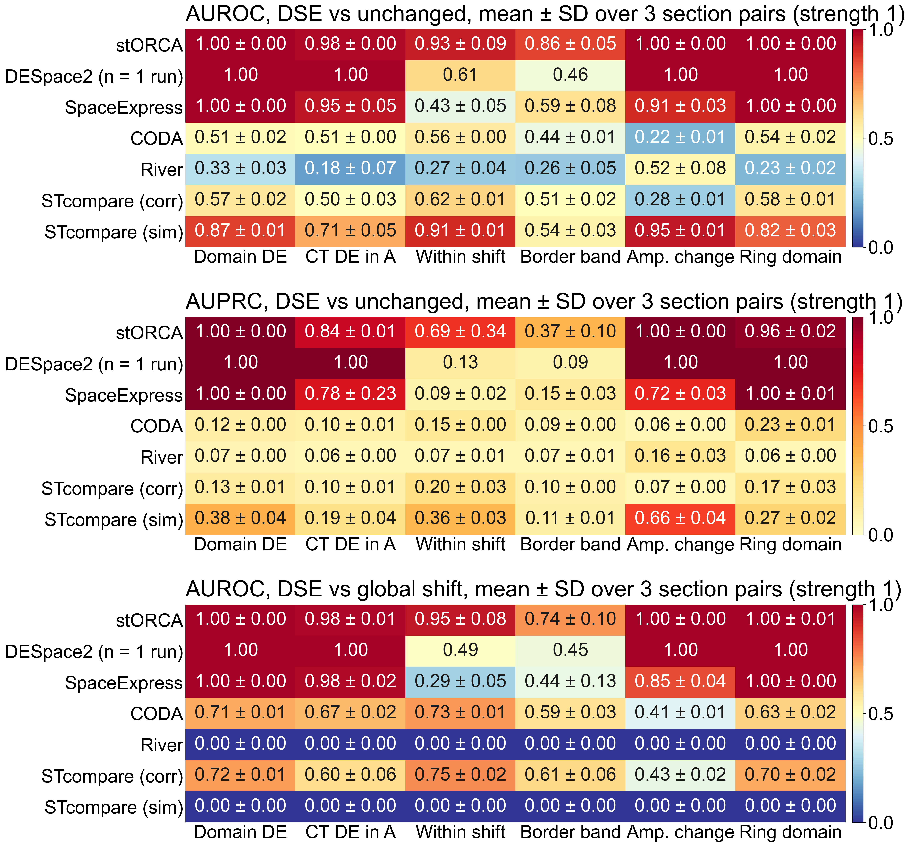
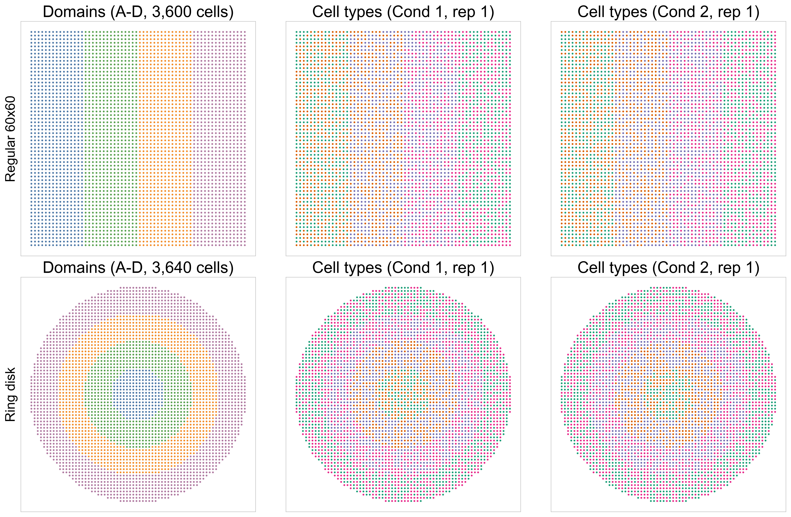
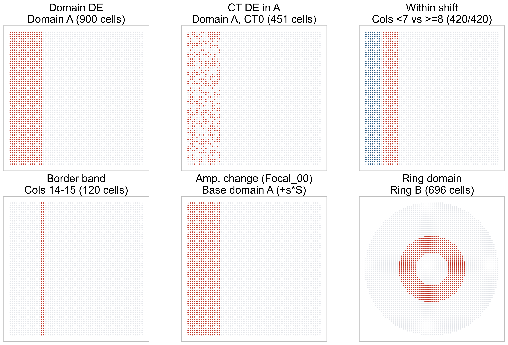
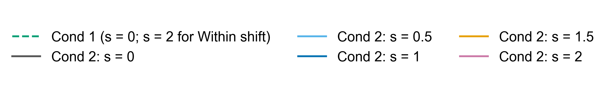
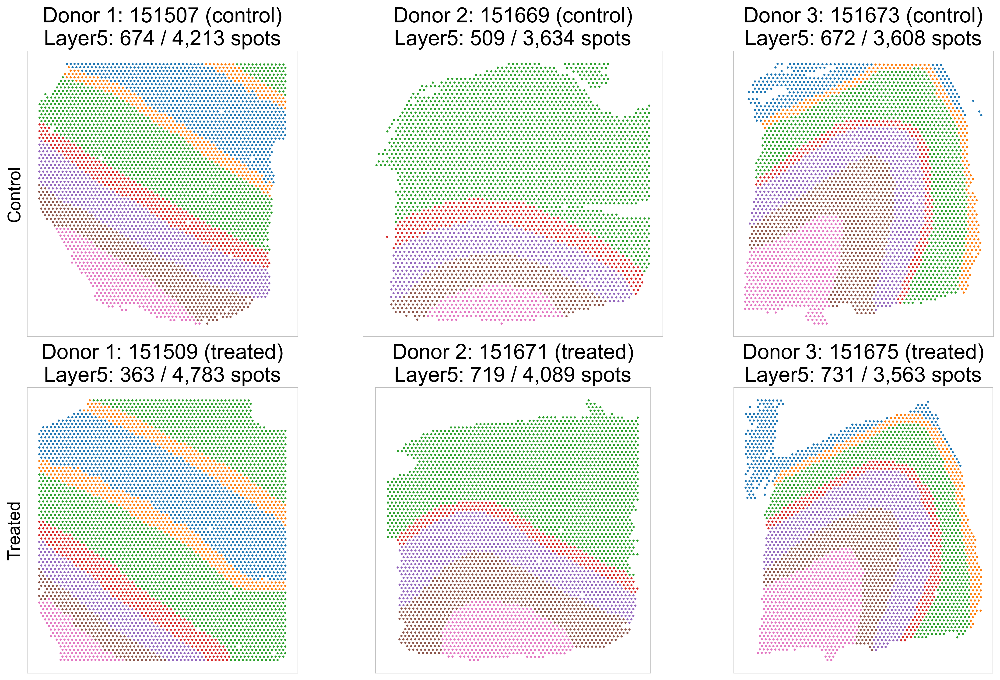
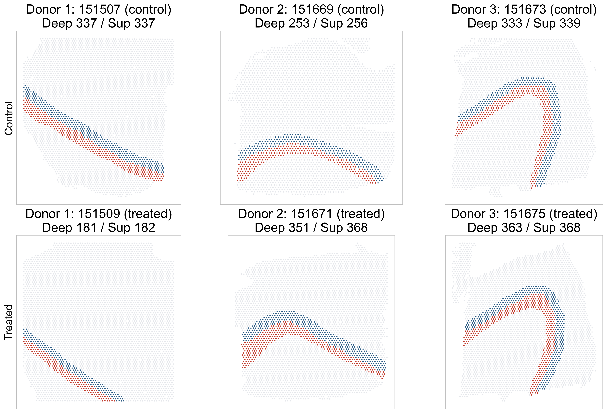
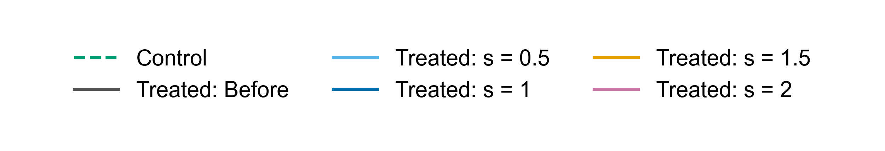

# 보충 그림 (Supplementary Figures)

## Supplementary Fig. 2

**Supplementary Fig. 2 | 벤치마크 AUPRC, 변동성 및 상위 순위 미끼 구성.** 합성 조직 시나리오(*s* = 1.0) 및 인간 DLPFC Visium 반합성 이식 벤치마크 전반에서 Fig. 2b, Fig. 2d, Fig. 2e를 보완하는 탐지 AUPRC, 쌍/시나리오 간 변동 폭(SD), 상위 순위 유전자 내 표적 대 전역 이동 미끼·불변 유전자 구성을 나타냅니다(보충 방법 S2.4, S2.7).

## Supplementary Fig. 3

**Supplementary Fig. 3 | 합성 조직 레이아웃 및 교란 영역.** **a**, 네 수직 도메인(A to D, 60 × 60 격자 내 각 15열, 3,600개 세포)과 네 동심원 고리(68 × 68 격자 내 반지름 34 이하, 3,640개 세포)에서 조건당 3개 반복 절편에 배치된 세포유형(`CT0` to `CT3`) 50:50 혼합 기저 레이아웃을 나타냅니다(Fig. 2a). **b**, 여섯 합성 시나리오(Domain DE, CT DE in A, Within-domain shift, Boundary band 14·15열, Amplitude increase, Ring domain)에서 조건 2(도메인 내 이동은 조건 1 대 조건 2)에 교란이 가해진 공간 영역 마스크입니다(보충 방법 S2.2).

## Supplementary Fig. 4

**Supplementary Fig. 4 | 합성 벤치마크 유전자 상태 범례.** Fig. 2a to c의 기반이 되는 60개 설계 표적 유전자(여섯 변화 기하학 각 10개)와 10개 전역 이동 미끼 유전자 전체 갤러리의 조건 및 효과 강도 범례(`Control`, 조건 2 강도 *s* = 0 to 2.0)입니다(보충 방법 S2.2). 70개 모의 유전자의 반복 절편별 고해상도 전체 공간 지도는 외부 보충 자산 번들에 별도 보관되어 있습니다.

## Supplementary Fig. 5

**Supplementary Fig. 5 | 인간 DLPFC 벤치마크 사용 절편 및 표적 Layer 5 절반 분할.** **a**, Fig. 2d, e에 사용된 세 공여자 기반 여섯 LIBD DLPFC Visium 절편(151507/151509, 151669/151671, 151673/151675; 절편당 3,563 to 4,783개 스팟)의 피질 층 주석(`Layer3` to `Layer6`, 백질 `WM`)입니다. **b**, 절편 좌표 회전 정렬 없이 모든 공여자에서 동일한 해부학적 방향으로 층 내 이동을 정의하기 위해 Layer 4까지 거리의 중앙값을 기준으로 나눈 Layer 5 심층부(deep)와 표층부(superficial) 절반입니다(보충 방법 S2.5).

## Supplementary Fig. 6

**Supplementary Fig. 6 | 인간 DLPFC 이식 유전자 상태 범례.** 인간 DLPFC 반합성 벤치마크(Fig. 2d, e; 보충 방법 S2.5)에서 `Layer DE`, `Within shift`, `Amplitude change`, `Global shift` 미끼로 수정된 40개 유전자 전체의 대조군 및 이식 강도 수준(`Control`, L1 to L4) 범례입니다. 여섯 절편과 전 강도에 걸친 40개 이식 유전자의 고해상도 개별 지도는 외부 보충 자산 번들에 별도 보관되어 있습니다.
