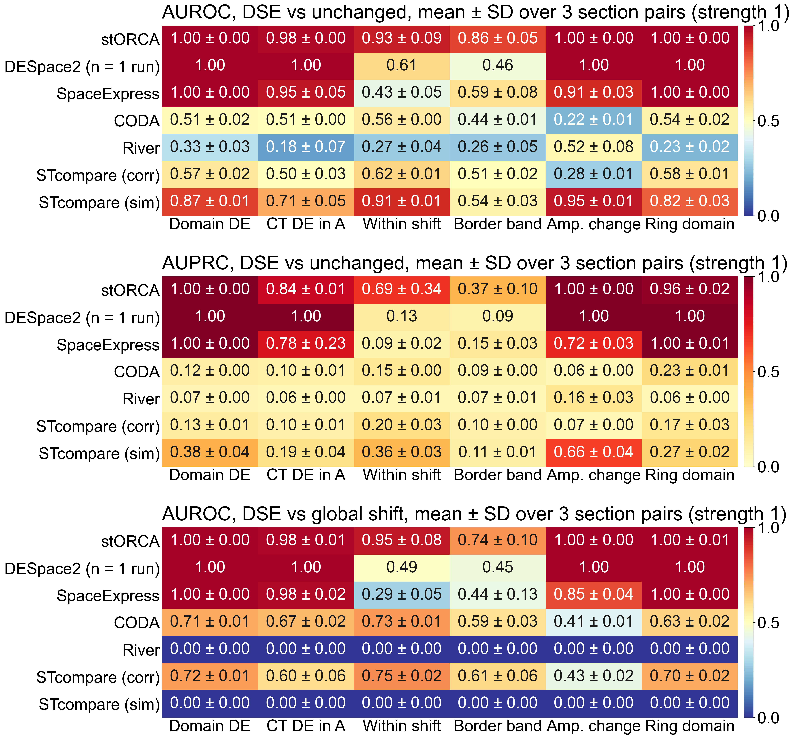
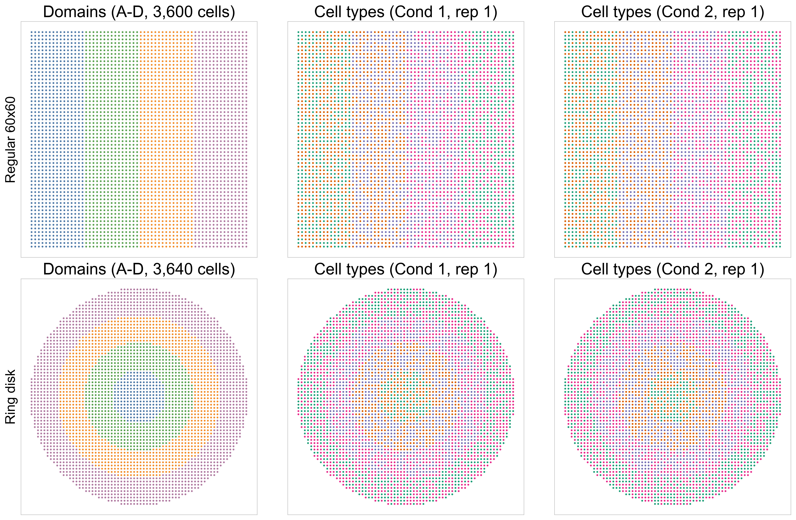
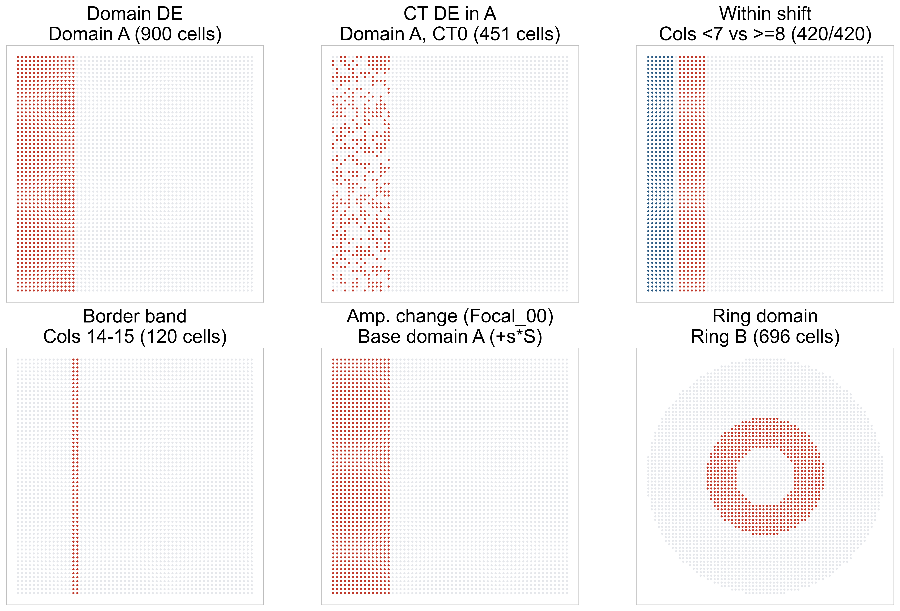
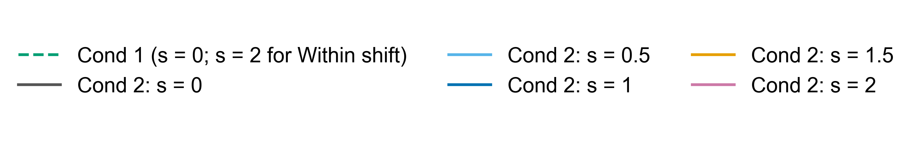
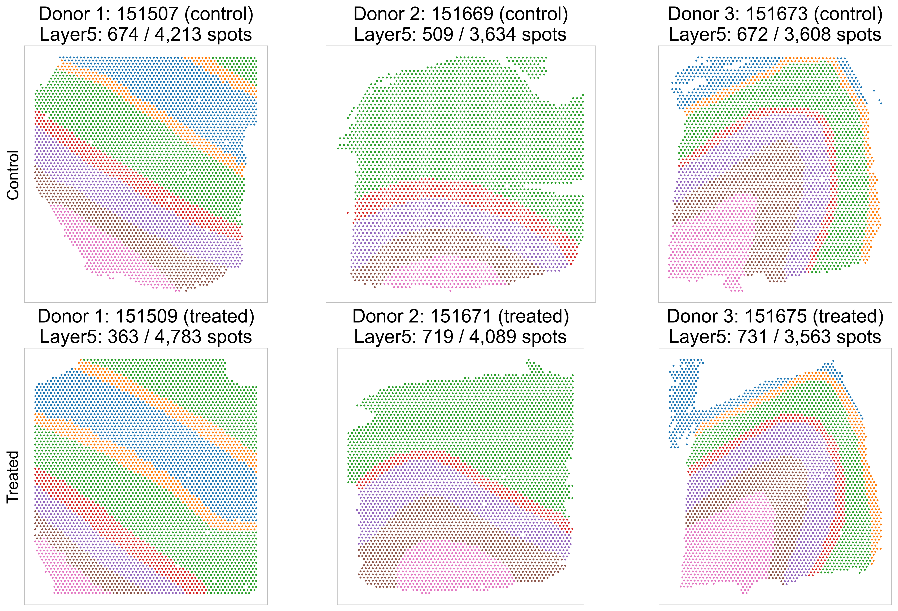
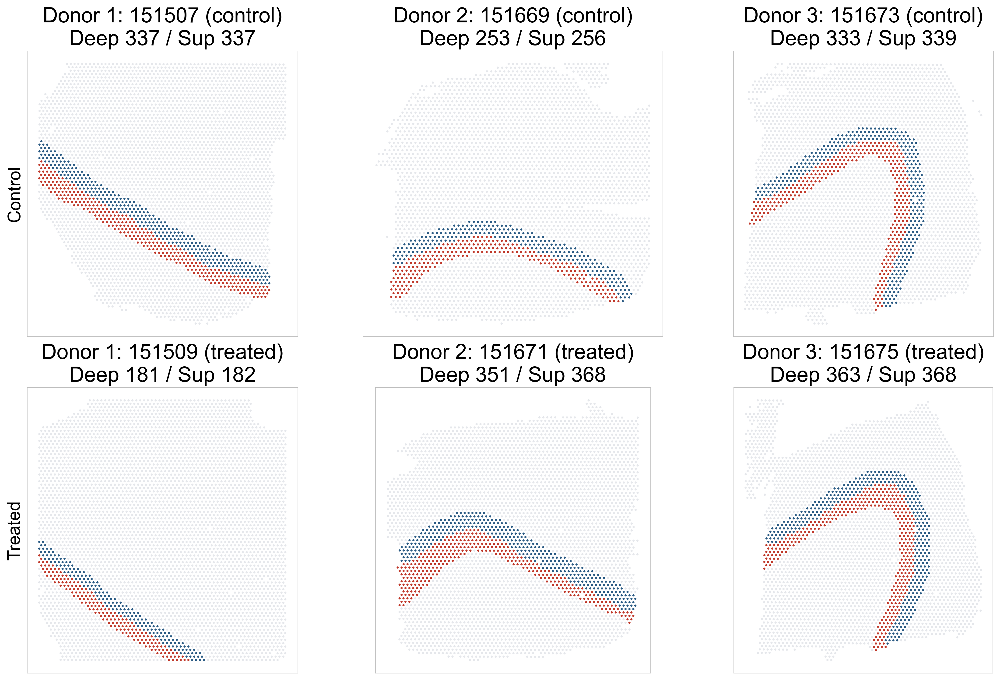
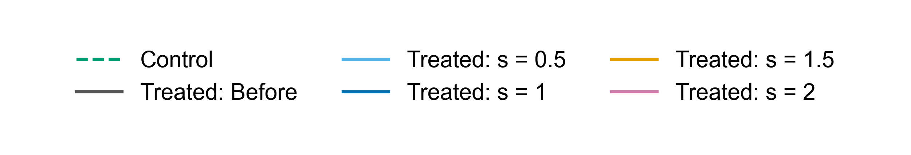

# Supplementary Figures

## Supplementary Fig. 2

**Supplementary Fig. 2 | Benchmark AUPRC, variability, and top-ranked decoy composition.** Detection AUPRC, cross-pair or cross-scenario variability, and the composition of top-ranked genes (focal positives versus global-shift decoys and unchanged background genes) complementing Fig. 2b, Fig. 2d, and Fig. 2e across the simulated tissue scenarios (*s* = 1.0) and human DLPFC Visium semi-synthetic implant benchmarks (Supplementary Methods S2.4, S2.7).

## Supplementary Fig. 3

**Supplementary Fig. 3 | Synthetic tissue layouts and perturbed spatial regions.** **a**, Baseline tissue geometries showing 50:50 mixtures of cell types (`CT0` to `CT3`) across four vertical domains (A to D, 15 columns each on a 60 × 60 lattice; 3,600 cells) and across four concentric radial rings (within radius 34 on a 68 × 68 lattice; 3,640 cells) across three replicate sections per condition (Fig. 2a). **b**, Spatial masks highlighting the perturbed cells or columns modified in Condition 2 (or Condition 1 versus Condition 2 for the within-domain shift) across the six synthetic scenarios: Domain DE, Cell-type DE in A, Within-domain shift, Boundary band (columns 14 and 15), Amplitude increase, and Ring domain (Supplementary Methods S2.2).

## Supplementary Fig. 4

**Supplementary Fig. 4 | Synthetic benchmark gene state legend.** Condition and effect-strength legend (`Control` and Condition 2 strengths *s* = 0 to 2.0) for the full gallery of 60 designed focal genes (10 per scenario across the six change geometries) and 10 global-shift decoys shown in summary in Fig. 2a to c (Supplementary Methods S2.2). Individual high-resolution expression maps for all 70 simulated genes across replicate sections are archived in the external supplementary asset bundle.

## Supplementary Fig. 5

**Supplementary Fig. 5 | Human DLPFC benchmark sections and target layer-5 halves.** **a**, Spatial layer annotations (`Layer3` to `Layer6` and white matter `WM`) across the six LIBD DLPFC Visium sections from three donors (151507/151509, 151669/151671, and 151673/151675; 3,563 to 4,783 spots per section) used in Fig. 2d, e. **b**, Partition of cortical layer 5 into deep (above median distance to layer 4) and superficial (below median distance to layer 4) halves used to define anatomically aligned layer-5 shifts without cross-section coordinate orientation (Supplementary Methods S2.5).

## Supplementary Fig. 6

**Supplementary Fig. 6 | Human DLPFC implanted gene state legend.** Baseline and implant-level legend (`Control` and levels L1 to L4) for the 40 genes modified across `Layer DE`, `Within shift`, `Amplitude change`, and `Global shift` decoys in the human DLPFC semi-synthetic benchmark (Fig. 2d, e; Supplementary Methods S2.5). Individual high-resolution spatial expression maps for all 40 implanted genes across all six sections and implant strengths are archived in the external supplementary asset bundle.
